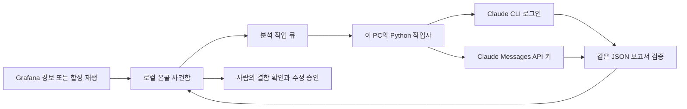

# 온콜 사건함 · 실측 경로와 남은 기능

[업무 화면 디자인 시안](design-preview/README.md)에서는 사건 목록, 500 RCA 검토, 보안 신호 판정, 사람 승인·PR·재시험, 모바일 알림을 다섯 화면으로 볼 수 있다. 시안의 숫자와 버튼은 실제 동작 근거가 아니다.

현재 상태: 사건 접수, 별도 분석 토큰, Markdown 분석 내보내기, CSRF 승인 기록, ntfy 실패 시 다음 접수 재시도를 구현했다. Grafana→온콜→ntfy→Android 에뮬레이터 사건 목록·링크를 확인했다. 전경의 새 알림은 재생, 배경의 새 알림은 직접 전송 시험이다. 로컬 Claude CLI 작업자의 합성 사건 자동 분석·보고서 첨부까지 실측했다. API 작업자는 같은 계약으로 구현해 모의 응답 시험을 통과했으며, 실제 API 호출은 키 설정 뒤 실측해야 한다. 승인 화면의 기록은 실제 코드 수정·PR·배포를 실행하지 않는다.

알림 제목의 한글 인코딩 수정과 실제 전달 검증의 경계는 [랩 RCA R07](../rca-20261114.md#r07--한글-알림-제목의-http-헤더-인코딩)에 기록한다.

## 사건 접수 경로

1. `POST /api/grafana`: Grafana 웹훅의 `firing` 알림 중 `sre_kind=error_500` 또는 `security_signal`만 받는다. `resolved`는 아직 상태 변경 기능이 없어 무시한다.
2. `POST /api/events`: 강의용 수동·과거 실측 재생 이벤트를 받는다. 화면에서 `Grafana 경보`, `재생 자료`, `수동 시험`을 구분한다.
3. 같은 출처·종류·지문·경로는 한 사건으로 묶는다. 같은 시각과 추적 ID의 웹훅 재시도는 새 알림으로 세지 않는다. 화면의 수는 **접수된 알림 수**이며 원본 로그 건수가 아니다.
4. 새 사건을 만들 때 ntfy 주제에 한 줄 알림을 게시한다. 전송 실패는 완료로 기록하지 않아 같은 사건의 다음 접수에서 재시도한다. 성공한 알림은 같은 사건의 다음 접수에서 중복 전송하지 않는다. 일반 후속 알림은 없고, 사람이 재시험·관찰 결과를 기록해 `확인 완료`로 바꿀 때 별도 알림을 보낸다.
5. 읽기 화면과 사건 접수 기록 Markdown은 HTTP Basic 인증을 요구한다. Markdown은 RCA 보고서가 아니다.
6. AI가 쓴 RCA·보안 조사 보고서는 **접수 토큰과 다른 분석 토큰**으로 `POST /api/incidents/{id}/analysis`에 붙인다. `/incidents/{id}/rca.md`는 이 분석을 별도 Markdown으로 내려받는다.
7. 웹의 `보류`, `확인 시험으로 결함 확인`, `수정 요청 승인`은 CSRF 토큰이 있어야 기록된다. 500은 RCA가 있어야 승인할 수 있고, 보안 신호는 조사 보고서 → 사람의 결함 확인 기록 → 별도 수정 승인 순서다. 결함 확인의 파일 경로는 **사람이 검토했다는 기록**이며 서버가 그 파일을 자동 시험하지는 않는다. 이 버튼 자체는 코드 변경을 시작하지 않는다.
8. 승인 뒤 `재시험과 관찰 기록`은 수정 전후 HTTP/본문 코드, 15분 이상 관찰 시간, 파일 경로가 있어야 `확인 완료`로 바뀌고 ntfy 알림을 보낸다. 이 입력도 **검증 결과를 사람이 기록하는 화면**이다. 서버가 실제 PR·배포·15분 측정을 대신 실행하지 않는다.

## 이 PC에서 자동 분석하기: CLI 또는 API

온콜 웹은 작업을 `pending → running → complete`로 기록한다. 실패하면 `failed`로 멈추므로 같은 사건의 모델 호출이 무한 반복되지 않는다. 작업자 한 개만 실행한다. 작업자는 사건의 최근 이벤트 최대 5개, 추적 ID 최대 3개에 대한 Loki 요약, 500 사건의 제한된 코드 발췌를 모델에 보낸다. 원문 로그와 토큰은 보내지 않는다. 보고서 검증이 통과하면 사건에 첨부하고 `measurements/local-analysis-...json`에 재현 자료를 남긴다.



**CLI 경로:** 이 PC에서 `claude auth status`가 로그인 상태인 뒤 다음을 실행한다. `analysis-demo-rca`는 과거 실측 trace를 **재생**한 사건을 새로 만든다. 실제 새 Grafana 경보로 표시하지 않는다.

```bash
make analysis-demo-rca
make analysis-cli INCIDENT=화면에_나온_번호
```

계속 들어오는 사건을 이 PC에서 자동 분석하려면 `make analysis-watch-cli`를 한 터미널에서 실행한다. 종료는 `Ctrl+C`다. CLI에는 도구를 주지 않고 세션 저장을 끄며 호출당 최대 예산을 0.50달러로 설정한다. 합성 사건 #5의 CLI 분석과 온콜 첨부는 `measurements/local-analysis-cli-5-20261114T123517Z.json`에 남겼다. 이 보고서는 읽기 전용 가설이지 결함 확정이나 수정 승인이 아니다.

**API 경로:** Claude Console에서 발급한 API 키를 이 PC의 현재 셸 환경에만 넣는다. 키를 채팅, 저장소, `.env`, 영상에 쓰지 않는다. API 작업자는 `https://api.anthropic.com/v1/messages`로 제한된 자료를 보내므로 모델 호출은 외부 서비스 통신이다. 온콜 웹과 작업자는 계속 이 PC에만 둔다.

```bash
read -s ANTHROPIC_API_KEY
export ANTHROPIC_API_KEY
make analysis-demo-security
make analysis-api INCIDENT=화면에_나온_번호
```

키가 있는 환경에서 계속 실행할 때는 `make analysis-watch-api`를 사용한다. 모델은 기본 `claude-sonnet-4-6`이며 `LAB_API_MODEL`로 바꿀 수 있다. API는 요청당 출력 최대 1200토큰, 사건당 한 번 호출로 제한했다. 실제 청구 비용의 하드 상한은 아니므로 사용량을 따로 확인한다. API 경로의 실제 호출·도착 시간·보고서 품질은 아직 미실측이다. 실패 작업은 `python3 tools/local_analysis_worker.py --backend cli --retry-failed 사건번호 --incident-id 사건번호`처럼 명시적으로 다시 대기시킨다.

작업 큐의 권한에는 사건 접수 토큰과 다른 분석 토큰을 쓴다. 보고서에는 관측·가설·미확인·근거·다음 행동이 필수다. AI는 코드나 배포 권한을 받지 않으며, 수정은 온콜 웹에서 사람이 결함을 확인하고 별도로 승인해야 한다.

Claude의 [Messages API](https://platform.claude.com/docs/en/api/messages/create), [JSON 스키마 출력](https://platform.claude.com/docs/en/build-with-claude/structured-outputs), [API 키 인증](https://platform.claude.com/docs/en/manage-claude/authentication)을 구현 기준으로 사용했다.

## 첫 통합 실측 순서

정상 트래픽 30분×5회가 모두 끝나 `measurements/baseline-summary.json`의 `completed_runs=5`, `issues=[]`, `metric_status`를 확인한다. 응답 시간이 불안정하면 HTTP 건수·비율만 경보 설계에 사용한다. 컨테이너 추가 부하가 기준선 측정을 바꾸지 않게 하기 위해서다.

```bash
make setup-oncall                # 이미 만든 경우 다시 실행하지 않음
make up-oncall
docker compose -f compose.yaml -f compose.oncall.yaml ps ntfy oncall
make replay-incidents           # 과거 실측 재생, Grafana 경보 아님
make alert-threshold-check     # 정상 5회 구간에서 1분 문턱 검증
make up-alerts                 # Grafana 실제 경보 규칙 로드
```

통합 시험에는 다음 증거를 각각 남긴다.

| 확인 | 완료 기준 |
|---|---|
| ntfy 접근 제어 | 인증 없는 구독·게시 거부, 게시 전용 토큰으로 구독 거부, 조회 전용 계정으로 게시 거부 |
| 사건함 | 재생한 500·보안 신호가 별도 카드. 같은 웹훅 재시도는 중복 접수 없음 |
| 실제 Grafana 경보 | 기준선에서 문턱 결정 후 500/보안 룰 설치, 주입 사건에서 실제 웹훅 수신. 화면 출처가 `Grafana 경보` |
| Android 에뮬레이터 | `Pixel_API34`에서 ntfy 앱 구독, 알림 도착·탭·사건 상세 열기. 앱 전경과 배경을 각각 촬영 |

`.env`와 `runtime/ntfy/server.yml`은 로컬 비밀값이므로 Git에 넣지 않는다. Mac의 포트는 `127.0.0.1`에만 연다. 에뮬레이터에서 PC의 로컬 서비스에 접근할 때는 `adb reverse`나 에뮬레이터의 호스트 주소를 사용하고, 사건함의 외부 공개는 하지 않는다. 실제 Android 기기의 절전 지연은 이 시험에서 알 수 없다.

설정 형식: [ntfy 접근 제어](https://docs.ntfy.sh/config/), [Grafana 파일 프로비저닝](https://grafana.com/docs/grafana/latest/alerting/set-up/provision-alerting-resources/file-provisioning/), [Grafana 웹훅](https://grafana.com/docs/grafana/latest/alerting/configure-notifications/manage-contact-points/integrations/webhook-notifier/).
